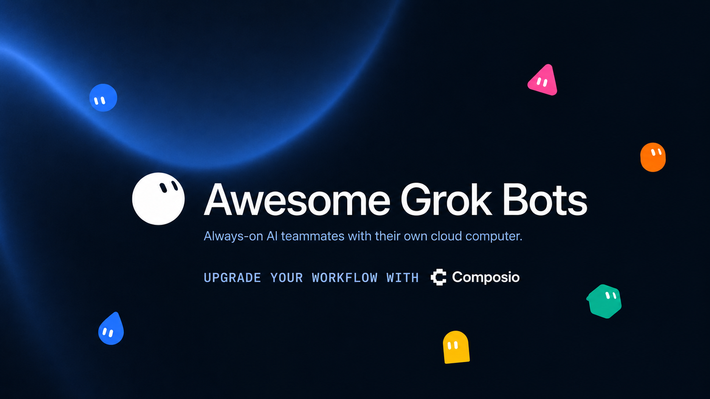

# Awesome Grok Bots

  

A curated list of practical and interesting Grok Bot templates, examples, and resources for building durable AI teammates.

The collection favors Bots with a clear job, a real workflow, useful tool connections, persistent context, and explicit approval boundaries. Linked templates stay with their creators; this repository curates and describes them without copying their private or public configuration.

## Contents

- [What Are Grok Bots?](#what-are-grok-bots)
- [Quickstart](#quickstart)
- [Bots](#bots)
  - [Development & Engineering](#development--engineering)
  - [Creative & Media](#creative--media)
  - [Home & Personal](#home--personal)
  - [Research, Knowledge & Decisions](#research-knowledge--decisions)
  - [Meta-Bots & Safety](#meta-bots--safety)
- [Interesting Demos](#interesting-demos)
- [Creating and Sharing Bots](#creating-and-sharing-bots)
- [Contributing](#contributing)
- [Resources](#resources)
- [License](#license)

## What Are Grok Bots?

Grok Bot is an agent product for handing real work to persistent AI teammates. Each Bot is a named agent with a focused job, its own conversation, durable context, and access to a cloud computer. It can use a browser, filesystem, terminal, connectors, and MCP tools to work inside real apps instead of stopping at a chat response.

Bots can continue working in the background, coordinate with one another, and turn a reliable process into a reusable **skill** or scheduled **routine**. Routines can keep running while your laptop is closed.

All Bots on one account share the same user-scoped cloud computer, including its files, browser sessions, and app logins. Each Bot has its own screen and can work in parallel, but separate Bots are not security boundaries.

A public template lets another person start from the same Bot configuration. Adding one creates a copy in the recipient's account; it does not transfer the creator's conversations, computer, or logins. See the official [Grok Bot overview](https://docs.x.ai/grok-bot/overview), [FAQ](https://docs.x.ai/grok-bot/faq), and [Bot sharing documentation](https://docs.x.ai/grok-bot/bots#share-a-bot).

## Quickstart

You need the Grok Bot desktop app for macOS or Windows, or the companion iOS app, plus an eligible Grok or Cursor plan.

1. Choose a Bot below and open its **template link**.
2. Inspect the public preview, including its job, skills, routines, and requested connections.
3. Select **Add to Grok Bot**.
4. Connect only the apps required for the workflow.
5. Run a supervised first task before enabling routines or consequential actions.

> [!CAUTION]
> Shared Bots are third-party configurations. Keep sending, spending, posting, deleting, deploying, production changes, and account changes behind explicit approval.

## Bots

### Development & Engineering

- [**Loops**](https://x.ai/bot/Ub3T7usX-c6yRQibQq83P) - Generalized engineering outer loop that gathers repository context, writes a testable `/goal`, launches coding agents, reviews their work, and merges only after verification. By [@mattyp](https://x.com/mattyp). [Source](https://x.com/mattyp/status/2093380201128595966)
- [**Mercury — Product Lead**](https://x.ai/bot/lk1yHfim5Ayra0Q0QlN3L) - Persistent technical and product lead for a research product. Mercury retains system understanding and release judgment while delegating narrow implementation work. By [@chiefjeeb](https://x.com/chiefjeeb). [Source](https://x.com/chiefjeeb/status/2094223658151502326)
- [**Projects Manager**](https://x.ai/bot/FU-Ev6_Ju4lFGWwWRD0GD) - Creates and coordinates specialist coder, designer, researcher, and writer Bots against Notion project rows. By [@ericzakariasson](https://x.com/ericzakariasson). [Source](https://x.com/ericzakariasson/status/2093381689041109349)

### Creative & Media

- [**Clip Bot**](https://x.ai/bot/Vk0cnF2c364QxNv-Xip1M) - Turns a YouTube interview or podcast into a captioned 16:9 highlight with karaoke captions and a source card. Published by Jason's team and [@ThisWeeknAI](https://x.com/ThisWeeknAI); the template credits Lon. [Team post](https://x.com/ThisWeeknAI/status/2093465404303720846) · [Jason's post](https://x.com/Jason/status/2093473021734408513)
- [**Sable**](https://x.ai/bot/oSvAMKX_ahD56ZmgwtRys) - Generates style-matched 2D game art, slices approved frames into game-ready PNGs, and can hand 3D concepts to Tripo or Meshy. By [@DannyLimanseta](https://x.com/DannyLimanseta). [Source](https://x.com/DannyLimanseta/status/2093381938484810054)
- [**Best Video Editor**](https://x.ai/bot/Do4CujP_kqnnc1KYnpOfI) - Handles cuts, recuts, shot notes, sound, titles, and pacing, then stops at a review-ready master. By [@XFreeze](https://x.com/XFreeze). [Source](https://x.com/XFreeze/status/2093442263200235974)
- [**Grok Bot Meetup Deck**](https://x.ai/bot/Ja9NzNTRz2ozzQLNfrJwI) - Turns a meetup deck's paper-canvas and blob-character visual language into a reusable presentation generator. By [@MaiYangAI](https://x.com/MaiYangAI). [Source](https://x.com/MaiYangAI/status/2094305288266666452)

### Home & Personal

- [**Home Robots**](https://x.ai/bot/3mf-UN4mGnCp8DbPBnW5u) - Controls Matter-connected lawn mowers and vacuums from one chat: start, pause, dock, and check status. By [@SawyerMerritt](https://x.com/SawyerMerritt). [Source](https://x.com/SawyerMerritt/status/2093387511095513222)
- [**HouseBot**](https://x.ai/bot/3ufXSXC-Z8OadVsV9yMLL) - Hunts rentals and homes every 12 hours across Redfin, Zillow, Craigslist, Facebook, MLS, ApartmentList, and other listing sites. By [@shubgaur](https://x.com/shubgaur). [Source](https://x.com/shubgaur/status/2093389744650818036)
- [**Be Happier**](https://x.ai/bot/0VC1XzREXRFGe0hVo-JEG) - Reads calendar and inbox context and proposes three concrete weekly moves to protect time and relationships. By [@lennysan](https://x.com/lennysan). [Source](https://x.com/lennysan/status/2093428147194847238)
- [**NYC Parent**](https://x.ai/bot/DiNI489Qte5ryNvZjOROb) - Hunts hard-to-book children's experiences while protecting time for a date night. By [@DennisonBertram](https://x.com/DennisonBertram). [Source](https://x.com/DennisonBertram/status/2094150767338832025)
- [**Flora Minder**](https://x.ai/bot/HC7kphHSxDzb639YlmI6O) - Tracks houseplants and schedules watering, repotting, and fertilizing reminders. By [@RichSilver](https://x.com/RichSilver). [Source](https://x.com/RichSilver/status/2094267086591680962)
- [**Subscription Watchdog**](https://x.ai/bot/PuAEE57P58Df5zskFY3pg) - Scans email for forgotten subscriptions and upcoming charges, then surfaces cancellation opportunities. By [@jxckvibe](https://x.com/jxckvibe). [Source](https://x.com/jxckvibe/status/2094145967809286341) · [Follow-up](https://x.com/jxckvibe/status/2094280601062760638)

### Research, Knowledge & Decisions

- [**Lennybot**](https://x.ai/bot/VjbtJ_qTdzbhJGmXdvTIc) - Answers product and growth questions against Lenny's published archive rather than the open web. By [@lennysan](https://x.com/lennysan). [Source](https://x.com/lennysan/status/2093428147194847238)
- [**Creator Fan List**](https://x.ai/bot/HU7XArfGhUgLnzVcr7neB) - Uses the X API to produce weekly top-100 and monthly top-500 fan lists for community building. By [@AdamLowisz](https://x.com/AdamLowisz). [Source](https://x.com/AdamLowisz/status/2094129673793896597)
- [**Blockchain Data Expert**](https://x.ai/bot/eyFr_G8h9UmrQHNpZpNfx) - Queries more than 15,000 Graph Protocol subgraphs to track selected tokens and protocols. By [@data_nexus](https://x.com/data_nexus). [Source](https://x.com/data_nexus/status/2094265024227192946)
- [**Harvey Specter**](https://x.ai/bot/lkkCqhC1jBFp6ouZOQd9m) - Researches leverage and negotiates an active deal, renewal, or quote, but cannot sign or spend. By [@liam_fallen](https://x.com/liam_fallen). [Source](https://x.com/liam_fallen/status/2093382733019939198)

### Meta-Bots & Safety

- [**Dr. Eggbot**](https://x.ai/bot/93gOz3op1UQdBdbekQFLK) - Interviews the user, then creates a tightly scoped Bot with one job, one voice, explicit anti-jobs, and a verification bar. By [@poteto](https://x.com/poteto). [Source](https://x.com/poteto/status/2093392701005946931)
- [**Alfred**](https://x.ai/bot/KZ9xav0Qad1U5QigEn7rh) - Designs, audits, and governs the smallest useful Bot organization, recommending which Bots to create, improve, merge, pause, or retire. By [@heyrobinai](https://x.com/heyrobinai). [Source](https://x.com/heyrobinai/status/2093393717545648305)
- [**Bot Template Scanner**](https://x.ai/bot/cGcG0msqfz7o7J3QMLhbE) - Inspects a public Bot template and returns a `CLEAN`, `WARN`, or `BLOCK` security assessment before installation. By [@bradshannon](https://x.com/bradshannon). [Source](https://x.com/bradshannon/status/2094260531305578886)

## Interesting Demos

Public examples worth following that do not currently have a verified install link:

- **Jason's Burner Accounts Bot** - Reviews replies for young, low-follower, or insulting accounts. [Demo](https://x.com/Jason/status/2094095953812717647)
- **Liam Fallen's specialist suite** - John Wick, Sherlock Holmes, Bounty Hunter, Fixer, Gatekeeper, Bodyguard, Reaper, Witness, Examiner, Morpheus, and Interrogator. [Overview](https://x.com/liam_fallen/status/2093382730352304381)

## Creating and Sharing Bots

A good Bot has a distinct goal, sources and tools, working style, approval boundary, and—when useful—a recurring schedule. Avoid broad “general helper” roles; give the Bot ownership of a concrete outcome.

To share one:

1. Remove secrets, internal URLs, customer information, and anything else that should not be public.
2. Open the Bot and copy its public share link.
3. Test the preview from a separate account or clean session.
4. Publish documentation or a demo showing the workflow, requirements, and approval boundaries.

Public share pages can expose the Bot's identity, description, skills, and routines. Read the official [sharing guidance](https://docs.x.ai/grok-bot/bots#share-a-bot) before publishing.

## Contributing

Contributions can come from anywhere: GitHub, a creator's website, documentation, a blog post, a demo, X, or another public primary source. The source is evidence; it is not the subject of the collection.

See [CONTRIBUTING.md](CONTRIBUTING.md) for inclusion and attribution requirements.

## Resources

### Official

- [Grok Bot overview](https://docs.x.ai/grok-bot)
- [Create and manage Bots](https://docs.x.ai/grok-bot/bots)
- [Skills and routines](https://docs.x.ai/grok-bot/skills-routines-and-automations)
- [Approvals, security, and privacy](https://docs.x.ai/grok-bot/approvals-security-and-privacy)

### Community

- [RongleCat/awesome-grok-bot](https://github.com/RongleCat/awesome-grok-bot) - Field cases, resources, and community examples.
- [majiayu000/awesome-grok-bot](https://github.com/majiayu000/awesome-grok-bot) - Community directory of public Grok Bot templates.
- [Grok Bot launch and template walkthrough](https://x.com/mattyp/status/2093379758306504935) by Matt Palmer.
- [Seven early Grok Bot examples](https://x.com/KettlebellDan/status/2093552887259361597) curated by KettlebellDan.

## Disclaimer

This independent community project is not affiliated with or endorsed by xAI, X, or any listed creator. Linked Bots are third-party configurations and can change after curation. Attribution reflects the public evidence available at review time; corrections are welcome.

## License

The index metadata and original summaries are released under [CC0 1.0 Universal](LICENSE). Linked third-party templates and source material remain under their respective owners' terms.
